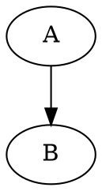

# Extended Kroki Diagram Support

**Date: 2025-09-04**

## Summary
This document describes the extension of Kroki-only rendering to additional diagram types that were previously unsupported in the editor/export pipeline.

## Added Diagram Types

Mapped internal `functionType` (code fence language) to Kroki endpoint:

| Function Type | Kroki Endpoint | Notes |
| ------------- | -------------- | ----- |
| graphviz      | graphviz       | `dot` alias also mapped |
| dot           | graphviz       | alias for Graphviz DOT |
| d2            | d2             | Modern diagram language |
| svgbob        | svgbob         | ASCII to SVG |
| wavedrom      | wavedrom       | Digital timing diagrams |
| nomnoml       | nomnoml        | Simple UML |
| pikchr        | pikchr         | PIC-like diagrams |
| erd           | erd            | Entity relationship diagrams |
| c4plantuml    | c4plantuml     | C4 model via PlantUML extension |
| blockdiag     | blockdiag      | Part of *diag tool family |
| actdiag       | actdiag        | Activity diagrams |
| seqdiag       | seqdiag        | Sequence diagrams (mapped also from legacy `sequence`) |
| nwdiag        | nwdiag         | Network diagrams |
| packetdiag    | packetdiag     | Packet diagrams |
| rackdiag      | rackdiag       | Rack layout diagrams |
| bytefield     | bytefield      | Byte layout diagrams |
| bpmn          | bpmn           | Business Process Model & Notation |
| wireviz       | wireviz        | Wiring harness diagrams |

Legacy fence `sequence` now maps to `seqdiag` for Kroki.

## Code Changes

1. `src/muya/lib/parser/render/kroki.js`
   - Extended `TYPE_MAP` with new entries and aliases.
   - Comment added referencing official Kroki diagram list.

2. `src/muya/lib/parser/render/renderBlock/renderLeafBlock.js`
   - Added new `case` labels in the diagram switch to enqueue blocks in `diagramCache` for asynchronous Kroki rendering.
   - Reused existing loading + cache mechanism—no structural change required.

No change required in `index.js` because generic diagram rendering already iterates over `diagramCache` entries and calls `kroki.isKrokiSupported()` / `renderKrokiToSvg`.

## Rendering Flow (Recap)

1. Markdown parsed → code fence creates a block with `functionType`.
2. `renderLeafBlock` hits the switch; diagram types push `{ code, functionType }` to `diagramCache` and show a temporary `Loading...` placeholder.
3. After virtual DOM patch, `StateRender.renderDiagram()`:
   - Dynamically imports `kroki.js`.
   - For each cache entry: checks support via `isKrokiSupported()` (now true for added types).
   - Sends POST to `${server}/${endpoint}/svg`.
   - Replaces placeholder with sanitized SVG or an error span.

## Error Handling

Existing error messages cover all new types (unsupported type, timeout, network, syntax/server errors). No additional branching required.

## Export Path

`exportHtml.js` uses the same Kroki adapter dynamically; it will automatically support the new types because they map through `kroki.isKrokiSupported()`.

## Testing Suggestions (Manual)

Create a markdown file containing multiple fenced code blocks, e.g.:

````markdown


```d2
app -> db
```

```wavedrom
{ signal: [ { name: 'clk',  wave: 'p....' } ] }
```

```bpmn
start=>start: Begin
end=>end: Finish
start->end
```
````

Verify each becomes an SVG or a descriptive error if the server lacks support.

## Future Improvements

- Dynamic capability discovery (fetch `/health` or introspection endpoint when Kroki adds one).
- Local cache (hash(code) → SVG) to avoid repeated server calls for identical content.
- Batch rendering for performance (if Kroki adds multi-diagram endpoint).

## Completion

All targeted missing diagram types have been integrated using the existing asynchronous Kroki rendering pipeline.
